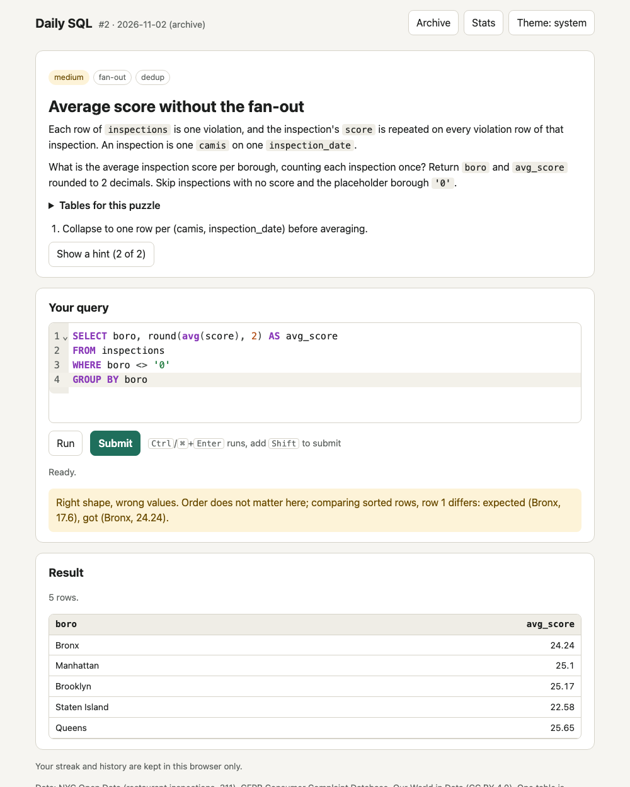

# Daily SQL

One SQL puzzle a day over real, messy public data, graded in the browser. TypeScript, Vite,
DuckDB-WASM, CodeMirror; static site on GitHub Pages, no backend.

**Play: [m4dd0ck.github.io/daily-sql](https://m4dd0ck.github.io/daily-sql/)**



This file is the reference: what exists and how it works. `RUNBOOK.md` is the procedures,
`CLAUDE.md` the agent rules, `TASK.md` the open items. `DATA_SOURCES.md` covers every table's
source, license and subsetting.

## What it is

Each day the page shows a short business question about NYC restaurant inspections, NYC 311
requests, CFPB student loan complaints or Our World in Data CO2 figures. You write SQL in the
editor, Run it as often as you like against DuckDB running in your browser, and Submit when it
answers the question. The page grades your result set against the reference answer by value,
so any correct query passes. Once solved you get the explanation, the reference query and a
share string:

```
Daily SQL #2 (medium)
🟨🟩 solved in 2
https://m4dd0ck.github.io/daily-sql/
```

⬛ is a SQL error, 🟥 the wrong number of columns or rows, 🟨 the right shape with wrong values,
🟩 solved. Streak and history stay in your browser's localStorage. The archive has every past
puzzle.

## Why it exists

SQL practice sites use tidy data. The work is mostly the mess: an average that is 7 points too
high because the score repeats on every violation row, `NOT IN` returning nothing because of
one NULL, `'None'` typed where a value is missing, a sentinel date of 1900-01-01, a report that
changed after late rows arrived. Every puzzle here is built around one of those, on real
public data, and the explanation says what the trap was.

## Quick start

Needs Node 24.2 or later (developed on 26).

```bash
npm ci
npm run dev        # http://localhost:5173
```

`npm run build` writes the static site to `dist/`; `npm run preview` serves it.

## Commands

Run as `npm run <name>`. The table is regenerated from `package.json` by the doc check; edit
the scripts there, not this table.

<!-- generated:commands start -->
<!-- do not hand-edit: regenerated by doc-check --fix -->
| Command | What it does |
|---|---|
| `npm run dev` | vite |
| `npm run build` | node scripts/fetch-extensions.ts && tsc --noEmit && vite build |
| `npm run preview` | vite preview |
| `npm run lint` | eslint . && prettier --check . |
| `npm run format` | prettier --write . |
| `npm run typecheck` | tsc --noEmit |
| `npm run test` | vitest run |
| `npm run test:e2e` | playwright test |
| `npm run test:live` | LIVE_URL=https://m4dd0ck.github.io/daily-sql/ playwright test |
| `npm run fetch-data` | node scripts/fetch-data.ts |
| `npm run fingerprints` | node scripts/fingerprints.ts |
| `npm run try-sql` | node scripts/try-sql.ts |
| `npm run fetch-extensions` | node scripts/fetch-extensions.ts |
<!-- generated:commands end -->

## How it works

### The page

- **Engine.** DuckDB-WASM runs in a Web Worker. The wasm bundles are copied into the build,
  and the Parquet extension (the browser build loads Parquet as an extension) is downloaded at
  build time, checked against a pinned SHA-256 and served with the site. The page makes no
  third-party request. Tables load on first use from `public/data/*.parquet`.
- **Run and Submit.** Both run the query through `CREATE TEMP TABLE ... AS <your query>`,
  which refuses anything but a query, after a scan that rejects a second statement. Run only
  shows the result (first 200 rows). Submit also grades it and records an attempt. A query
  still running after 15 seconds stops the worker; the next query starts a fresh one.
- **Grading.** Both results are read back with every column cast inside DuckDB to DOUBLE,
  BOOLEAN or text, so 3, 3.0 and DECIMAL 3.00 are equal and a DATE equals the same day as a
  midnight TIMESTAMP. Then, in order: column count, column names (only where the puzzle says
  they matter), row count, and the first differing row. Rows are sorted first unless the
  puzzle grades order. Numbers match within the puzzle's absolute tolerance.
- **Daily rotation.** The puzzle number is the number of days since 2026-11-01 plus one,
  counted in America/New_York, so the day rolls over at midnight New York time for everyone.
  Puzzles are served in file order and start again from #1 when the bank runs out.
- **Progress.** Attempts, hints, solves and the theme choice live in localStorage behind
  try/catch. When storage is blocked the page keeps them in memory and says so.

### The puzzles

One YAML file per puzzle in `puzzles/`: id, slug, title, difficulty, datasets, skills,
prompt, hints, reference SQL, grading rules (`ordered`, `tolerance`, `column_names`) and the
explanation. A zod schema checks them at build time and in the tests; the page validates them
again on load. Vite compiles the YAML to JSON, so the page ships no YAML parser.

### How it stays honest

- **One engine.** The tests run DuckDB-WASM's Node build, the same engine and version as the
  page, so a query that passes in the tests passes in the browser.
- **Answer fingerprints.** `puzzles/fingerprints.json` holds a hash of every reference answer.
  The tests rerun every reference query on the committed Parquet and fail if an answer moved.
- **Browser check.** A Playwright test solves every puzzle in headless Chromium against the
  production build, plus a wrong answer, the time limit and blocked storage.
- **Known traps are tested.** The fan-out average and `NOT IN` over NULLs are graded as wrong,
  and `NOT IN` with the NULLs filtered out is graded as right.

## Layout

```
puzzles/          one YAML per puzzle, fingerprints.json (generated); committed
public/data/      the Parquet tables and sources.json (generated by fetch-data); committed
public/extensions/ DuckDB Parquet extension (downloaded at build); gitignored
src/              page, engine wrappers, grading, rotation, storage, puzzle schema
scripts/          fetch-data, fetch-extensions, fingerprints, try-sql
tests/            vitest: grading, rotation, share, storage, schema, data, reference answers
e2e/              Playwright smoke tests against the production build
data/raw/         raw downloads cached by fetch-data; gitignored
dist/             build output; gitignored
```

## Outside the repo

- GitHub Pages, deployed by `.github/workflows/deploy.yml` (source: GitHub Actions).
- The data sources and their terms: `DATA_SOURCES.md`.
- `extensions.duckdb.org`, only at build time, for the Parquet extension file.

## Vocabulary

- **Puzzle number**: the day count from 2026-11-01 (#1); the share string and the archive use it.
- **Attempt**: one Submit. Run never counts, and neither does an empty editor or a second statement.
- **Reference result**: what the puzzle's reference SQL returns, computed in the page.
- **Fingerprint**: row count, column count and SHA-256 of a reference result, sorted unless order is graded.

## Decisions

- 2026-11-01 America/New_York for the puzzle day, #1 on 2026-11-01: most of the data is New
  York's, and one fixed zone means one puzzle per day worldwide with no server.
- 2026-11-01 DuckDB-WASM pinned to 1.33.1-dev57.0 (DuckDB v1.5.4): it is what npm tags
  `latest`; an unpinned dev tag would move the engine under the fingerprints.
- 2026-11-01 Tests run DuckDB-WASM's own Node build rather than the native DuckDB package: one
  engine for tests and page, so no version or behaviour drift between them.
- 2026-11-01 Parquet extension self-hosted with a pinned hash: the browser build does not link
  Parquet in, and loading it from extensions.duckdb.org at runtime would be a third-party
  request on every visit.
- 2026-11-01 TypeScript 6.0.3, not 7.x: typescript-eslint 8.72 supports TypeScript below 6.1.
- 2026-11-01 Normalize in SQL, grade in TypeScript: Arrow values (bigint, decimal buffers,
  epoch dates) are awkward in JS; casting in DuckDB leaves the grader a pure, tested function.
- 2026-11-01 Tolerance is absolute (plus a 1e-9 relative allowance for float noise): a puzzle
  that asks for 2 decimals means ±0.005 whatever the size of the number.
- 2026-11-01 The reference SQL ships in the bundle: a static site cannot hide it, and like any
  daily puzzle the game relies on players not reading the source.
- 2026-11-01 The "first differing row" feedback shows that row of the expected answer: it
  reveals one row, and it is the most useful thing to see when a value is off.
- 2026-11-01 SQL errors on Submit count as attempts (⬛); an empty editor or a second
  statement does not: the first is a wrong answer, the others are typos.
- 2026-11-01 Placeholders and duplicates are kept exactly as published: they are what the
  puzzles are about. Columns that could describe individuals (addresses, consumer ZIPs,
  narratives, phones) are dropped.
- 2026-11-01 One synthetic table, `synthetic_grade_feed`, derived from real inspections: no
  public feed shows mixed date formats, re-sends, corrections and late loads together. It is
  named and labelled synthetic everywhere it appears.
- 2026-11-01 Subsets by key suffix (CAMIS ending in 7, 311 keys ending in 42): reproducible
  without a random seed, and a restaurant keeps its whole history.
- 2026-11-01 Puzzles authored in YAML, compiled to JSON by a Vite plugin: multi-line SQL reads
  well in YAML, and the page does not need a YAML parser.
- 2026-11-01 No saved editor drafts: not needed for a puzzle you finish in one sitting.

## History

- 2026-11-01 First version: puzzle bank, five tables, grading, archive, share string, Pages workflow.

## Development

```bash
npm test               # vitest, includes every reference answer
npm run lint           # eslint and prettier
npm run typecheck
npm run test:e2e       # builds, serves dist, runs Playwright (needs: npx playwright install chromium)
```

## Pointers

- RUNBOOK.md: how to operate it
- CLAUDE.md: rules for agents working here
- TASK.md: what is open
- DATA_SOURCES.md: where each table comes from
